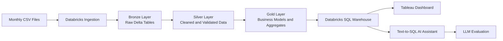

# CaffAIne: Intelligent Sales Data Platform

CaffAIne is a coffee shop sales intelligence platform built with Databricks and medallion architecture. It incrementally processes monthly sales data through Bronze, Silver, and Gold layers, powers an interactive Tableau dashboard, and provides an evaluated Text-to-SQL AI assistant.

The project demonstrates an end-to-end workflow spanning data ingestion, data-quality validation, lakehouse modeling, business intelligence, generative AI, and LLM evaluation.

## Architecture

