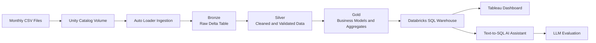

# CaffAIne: Intelligent Sales Data Platform

CaffAIne is an end-to-end coffee shop sales intelligence platform built on Databricks. It incrementally ingests monthly sales files, processes them through a medallion architecture, and prepares trusted business data for analytics, Tableau dashboards, and an evaluated Text-to-SQL AI assistant.

The current implementation includes the local data-preparation workflow and the Bronze and Silver lakehouse layers. Gold models, Tableau reporting, the AI assistant, and LLM evaluation are planned next. RAG is intentionally outside the current project scope.

## Architecture



## Current Data Flow

1. The original coffee sales dataset is split into six monthly CSV files with a local Pandas script.
2. Monthly files land in the Unity Catalog volume `/Volumes/caffaine/bronze/source_files`.
3. Databricks Auto Loader incrementally ingests new files into `caffaine.bronze.coffee_sales_raw`.
4. The Silver pipeline casts source strings to appropriate data types, standardizes text fields, creates a transaction timestamp, calculates sales amount, and applies data-quality expectations.
5. SQL validation queries confirm row counts, schema, file-level ingestion, null handling, calculated values, and transaction uniqueness.

## Progress

### Repository and data preparation

- [x] Create the project repository and Python package structure
- [x] Add environment and dependency configuration with `pyproject.toml`
- [x] Add Git ignore rules for local environments, secrets, caches, and Databricks state
- [x] Inspect the source schema and convert `transaction_date` to a date type
- [x] Split the source dataset into monthly CSV files
- [x] Validate that the monthly files contain all **149,116** source records

### Databricks foundation

- [x] Create the `caffaine` Unity Catalog catalog
- [x] Create the `caffaine.bronze` schema
- [x] Create the managed `source_files` volume
- [x] Create the `caffaine.silver` schema
- [x] Upload the six monthly files covering January through June 2023
- [x] Connect the Databricks workspace to the GitHub repository

### Bronze layer

- [x] Build incremental CSV ingestion with Databricks Auto Loader
- [x] Preserve raw source columns as strings
- [x] Capture source filename, source path, modification time, and ingestion time
- [x] Enable rescued-data handling for unexpected source fields
- [x] Validate all six source files and **149,116** Bronze records
- [x] Confirm zero rescued rows

### Silver layer

- [x] Cast identifiers, quantities, dates, timestamps, and monetary values
- [x] Trim descriptive text columns
- [x] Create `transaction_timestamp`
- [x] Calculate `sales_amount = transaction_qty × unit_price`
- [x] Apply seven pipeline quality expectations
- [x] Correctly parse both one-digit and two-digit transaction hours
- [x] Validate **149,116** Silver records with no rejected rows
- [x] Confirm zero null critical fields, zero incorrect sales amounts, and zero duplicate transaction IDs

### Next milestones

- [ ] Create the `caffaine.gold` schema
- [ ] Design Gold fact, dimension, and aggregate tables
- [ ] Add Gold-layer validation queries
- [ ] Configure repeatable pipeline execution and monitoring
- [ ] Connect Tableau to the Databricks SQL Warehouse
- [ ] Build the executive sales dashboard and interactive analyses
- [ ] Define the semantic context and approved query surface for Text-to-SQL
- [ ] Build the Text-to-SQL AI assistant
- [ ] Create a benchmark dataset of business questions and expected SQL
- [ ] Evaluate SQL correctness, execution success, result accuracy, and response quality
- [ ] Add automated tests and continuous integration
- [ ] Complete deployment and usage documentation

## Verified Results

| Check | Result |
|---|---:|
| Source records | 149,116 |
| Monthly files | 6 |
| Bronze records | 149,116 |
| Silver records | 149,116 |
| Rescued Bronze rows | 0 |
| Null transaction IDs | 0 |
| Null transaction timestamps | 0 |
| Null sales amounts | 0 |
| Incorrect sales amounts | 0 |
| Duplicate transaction IDs | 0 |

Monthly source counts:

| Month | Records |
|---|---:|
| 2023-01 | 17,314 |
| 2023-02 | 16,359 |
| 2023-03 | 21,229 |
| 2023-04 | 25,335 |
| 2023-05 | 33,527 |
| 2023-06 | 35,352 |

## Data Quality Rules

The Silver pipeline currently requires:

- a non-null transaction ID;
- a valid transaction date and timestamp;
- a positive transaction quantity;
- non-null store and product IDs; and
- a positive unit price.

Rows that fail these expectations remain preserved in Bronze but are excluded from the clean Silver table.

## Repository Structure

```text
CaffAIne-Intelligent-Sales-Platform/
├── data/
│   ├── source/
│   │   └── coffee_sales.csv
│   └── monthly/
│       ├── coffee_sales_2023_01.csv
│       ├── coffee_sales_2023_02.csv
│       ├── coffee_sales_2023_03.csv
│       ├── coffee_sales_2023_04.csv
│       ├── coffee_sales_2023_05.csv
│       └── coffee_sales_2023_06.csv
├── scripts/
│   └── split_sales_by_month.py
├── sql/
│   ├── 00_Setup_CaffAIne_Unity_Catalog.dbquery.ipynb
│   ├── 01_Validate_Bronze_Ingestion.dbquery.ipynb
│   └── 02_Validate_Silver_Layer.dbquery.ipynb
├── src/
│   └── caffaine/
│       └── pipelines/
│           ├── bronze/
│           │   └── bronze_sales.py
│           ├── silver/
│           │   └── silver_sales.py
│           └── gold/
│               └── __init__.py
├── pyproject.toml
└── README.md
```

The `.dbquery.ipynb` files are Databricks SQL Editor query assets committed through a Databricks Git folder. Query outputs are not stored in Git.

## Tech Stack

| Area | Technologies |
|---|---|
| Local data preparation | Python 3.12, Pandas |
| Lakehouse platform | Databricks Free Edition, Unity Catalog, Delta Lake |
| Pipeline framework | Lakeflow Declarative Pipelines |
| Incremental ingestion | Databricks Auto Loader (`cloudFiles`) |
| Transformations | PySpark, Spark SQL |
| Data quality | Lakeflow expectations, SQL validation queries |
| Business intelligence | Databricks SQL Warehouse, Tableau *(planned)* |
| Generative AI | Text-to-SQL assistant *(planned)* |
| Evaluation | Executable SQL and LLM response evaluation *(planned)* |
| Source control | Git, GitHub, Databricks Git folders |

## Local Setup

Create and activate a virtual environment:

```bash
python -m venv .venv
source .venv/bin/activate
```

Install the project in editable mode:

```bash
python -m pip install -e .
```

Regenerate the monthly landing files:

```bash
python scripts/split_sales_by_month.py
```

The script writes the monthly files to `data/monthly` and validates that their combined row count matches the source dataset.

## Databricks Assets

| Asset | Purpose |
|---|---|
| `00_Setup_CaffAIne_Unity_Catalog` | Creates the catalog, schemas, and source-file volume |
| `01_Validate_Bronze_Ingestion` | Validates Bronze counts, schema, file ingestion, and rescued rows |
| `02_Validate_Silver_Layer` | Validates Silver counts, schema, critical fields, calculations, and duplicates |
| `bronze_sales.py` | Defines incremental raw ingestion and ingestion metadata |
| `silver_sales.py` | Defines typed transformations, derived fields, and quality expectations |

## Project Scope

The final platform will support two primary consumers:

- **Analytics users**, through curated Gold models and Tableau dashboards.
- **Business users**, through a Text-to-SQL assistant that queries an approved analytical surface.

The AI component will include explicit evaluation rather than relying only on qualitative examples. Planned metrics include valid SQL generation, execution success, result equivalence, and answer relevance.
